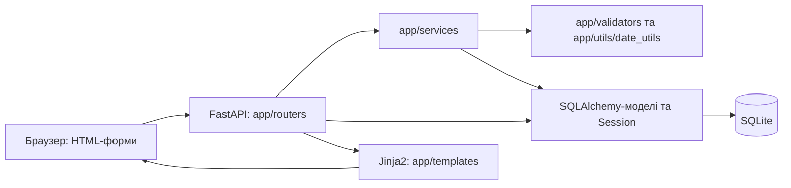

# Архітектура project_2

Карта коду гілки `testing`. Актуальний код має пріоритет; стан реалізації та результати перевірок наведені в [CURRENT_STATE.md](CURRENT_STATE.md).

## Навігація за завданням

Шляхи в таблицях наведено від кореня репозиторію. Для конкретного завдання достатньо відповідного рядка та пов'язаного розділу нижче.

| Завдання | Основні файли |
| --- | --- |
| Список, створення, базове редагування людини | `app/routers/persons.py`, `app/services/service_person_create.py`, `app/templates/persons.html`, `app/templates/person_form.html` |
| Неповна дата народження | `app/utils/date_utils.py`, `app/services/service_person_group_data_validation.py`, `app/models/person.py`, `tests/test_birth_date.py` |
| Історія ПІБ | `app/routers/person_name.py`, `app/services/service_person_name.py`, `app/models/person_identity.py`, `app/templates/person/components/names_history.html` |
| Історія звань | `app/routers/person_rank.py`, `app/services/service_person_rank.py`, `app/models/person_military_service.py`, `app/templates/person/components/rank_history.html` |
| Посади, призначення, фільтри | `app/routers/person_positions.py`, `app/services/service_person_positions.py`, `app/models/person_positions.py`, `app/templates/person_positions.html`, `tests/test_person_positions.py` |
| Видимість колонок, Checkbox Tree | `app/table_columns.py`, `app/templates/components/column_visibility.html`, `app/static/js/column_visibility.js`, `app/static/css/column_visibility.css`, `tests/test_table_columns.py`, `tests/browser/` |
| Події | `app/services/service_for_person_event.py`, `app/services/service_common_event_func.py`, `app/models/person_event.py`, `app/validators/event_validatotor.py` |
| Довідники та початкові дані | `app/models/reference_book.py`, `app/seeds/seed_structure.py`, `app/seeds/seed_reference.py`, `app/config.py`, `reference_data.xlsx` |
| Підключення застосунку, БД, тестів | `app/main.py`, `app/database/`, `requirements.txt`, `tests/conftest.py` |

## Компоненти та потік запиту

Вебзастосунок — FastAPI з серверним рендерингом Jinja2. [app/main.py](../app/main.py) створює `app` і підключає чотири роутери: `persons`, `person_name`, `person_rank`, `person_positions`. JavaScript і CSS сторінок переважно розміщені в HTML; спільний компонент видимості колонок має файли в `app/static/`. `StaticFiles` у `app/main.py` обслуговує `/static` з абсолютного шляху `BASE_DIR / "static"`. Bootstrap завантажується з `cdn.jsdelivr.net`. Окремого frontend-збирання у репозиторії немає. PySide6 є в залежностях, але не є точкою входу поточного вебінтерфейсу.

GET-маршрути зазвичай самі виконують ORM-запити й передають об'єкти в шаблони. POST-маршрути приймають `Form`, викликають сервіси та переважно повертають перенаправлення `303`. Це не суворо відокремлена архітектура з обов'язковим шаром репозиторіїв: `PersonRepository` існує, але активні роутери та сервіси його не використовують.

## База даних і життєвий цикл сесій

- [app/database/base.py](../app/database/base.py) містить спільний `Base`; [app/models/__init__.py](../app/models/__init__.py) реєструє моделі для `Base.metadata`.
- [app/database/db.py](../app/database/db.py): SQLite `data/database/project2.db`, `engine`, `SessionLocal`, залежність FastAPI `get_db()`. Вона відкриває сесію на запит і закриває її у `finally`.
- `app/database/db_test.py`: окремі `engine_test`, `SessionLocal_test`, `get_test_db()` для `data/database/project2_test.db`.
- Обидва шляхи БД відносні до робочого каталогу. Шаблони також шукаються відносно нього: `app/templates`.
- `app/database/init_db.py` та `init_test_db.py` імпортують реєстр моделей і викликають `create_all`. Це створення відсутніх таблиць, а не міграція існуючих. Механізму версійних міграцій у репозиторії немає.
- Активні сервіси персон, ПІБ, звань і посад отримують `db` від виклику та самі виконують `commit`. Сервіс посад має `rollback` при помилці; єдиного транзакційного обгортання всіх сервісів немає. Сервіс подій відкриває власні сесії.

## Моделі та зв'язки

| Файл / клас | Таблиця | Призначення та зв'язки |
| --- | --- | --- |
| `person.py` / `Person` | `persons` | Базова людина: ID, nullable унікальний `tax_number`, окремі nullable `birth_day`, `birth_month`, `birth_year`. ORM-колекції `names`, `ranks`, `service_history`, `positions`. |
| `person_identity.py` / `PersonName` | `person_names` | ПІБ та необов'язкові латинські варіанти; FK на `Person`, зворотний ORM-зв'язок `person`. |
| `person_identity.py` / `Passport` | `passports` | Тип, серія, номер, орган і дати видачі/закінчення; FK на `Person`. ORM-колекції паспортів у `Person` не оголошено. |
| `person_military_service.py` / `PersonRank` | `person_ranks` | FK на `Person` і довідник `Rank`, номер та дата наказу; ORM-зв'язки `person`, `rank`. |
| `person_military_service.py` / `PersonServiceHistory` | `person_service_history` | Вид служби, частина, текстова посада, дати й наказ; FK та ORM-зв'язок на `Person`. Це окрема сутність від штатного призначення. |
| `reference_book.py` / `Rank` | `ranks` | Унікальний `code` і сім відмінкових форм звання. |
| `reference_book.py` / `Position` | `positions` | Унікальний `position_number`, код, підрозділ, коротка назва та сім відмінкових форм посади. Колекція `persons` містить об'єкти `PersonPosition`. |
| `person_positions.py` / `PersonPosition` | `person_positions` | FK `person_id` і `position_id` мають **окремі** `unique=True`: одна людина займає щонайбільше одну посаду, одна посада має щонайбільше одного призначеного. Зв'язки `person`, `position`. Історію призначень не зберігає. |
| `event_type.py` / `EventType` | `event_types` | Код і назва типу події, колір, ознаки активності та виключності. |
| `event_subtype.py` / `EventSubtype` | `event_subtypes` | Код, назва, активність; FK на `EventType`. |
| `person_event.py` / `PersonEvent` | `person_events` | FK на `Person`, `EventType`, необов'язковий `EventSubtype`; початок, тривалість, кінець, наказ, мета, місце, примітка, статус. ORM-колекцію `Person.events` не оголошено. |

Файли моделей у таблиці розташовані в `app/models/`. `HistoryModel` у `person_history_model.py` — абстрактний базовий клас для `PersonName`, `Passport`, `PersonRank`, `PersonServiceHistory`: додає `created_at`, `updated_at`, `is_active`. Він **не** додає `date_from` / `date_to` й не є журналом усіх змін. Базові `Person`, `PersonPosition` і `PersonEvent` від нього не успадковуються.

Основні зв'язки: `Person → PersonName[]`, `Person → PersonRank[] → Rank`, `Person → PersonServiceHistory[]`, `Person ↔ PersonPosition ↔ Position`. Паспорт і подія посилаються на людину через FK; підтип події — на її тип. Назви колекцій не скасовують обмежень унікальності в `PersonPosition`.

## Сервіси та правила даних

| Модуль у `app/services/` | Поточна відповідальність |
| --- | --- |
| `service_person_create.py` / `ServicePersonCreate` | Створює `Person` і початковий активний `PersonName`; базове редагування змінює активний запис ПІБ на місці, без нового запису історії. |
| `service_person_checking.py` / `ServicePersonCheck` | Перевіряє наявність людини й унікальність ІПН, з можливістю виключити поточну людину. |
| `service_person_group_data_validation.py` / `DataGroupValidate` | Нормалізує базові дані та ПІБ через `PersonValidator` і `validate_date_components`. |
| `service_person_name.py` / `ServicePersonNameFunc` | Додавання нового ПІБ деактивує поточний; редагування працює з конкретним записом, зокрема частковими даними. Є перемикання активного запису та видалення неактивного з підтвердженням `DELETE`. |
| `service_person_rank.py` / `ServicePersonRankFunc` | Звання обирається з `Rank`. Перше стає активним, наступне додається неактивним; активність перемикається окремо. Додавання перевіряє повтор того самого звання в історії. Є редагування та видалення неактивного запису з `DELETE`. |
| `service_person_positions.py` / `ServicePersonPositionFunc` | Вибірка штатних посад, каскадні фільтри, сортування, лічильники; призначення, переведення, заміна та звільнення посади. |
| `service_common_event_func.py` / `CommonEventFunc` | Пошук подій, типів і підтипів; перевірка належності підтипу до типу. Містить відомий дефект вибірки. |
| `service_for_person_event.py` / `PersonEventService` | Підготовка, створення, зміна, видалення події, пошук за датами та конфліктами. У вебмаршрутах не використовується; реалізація має дефекти, наведені в `CURRENT_STATE.md`. |
| `service_common_person_func.py` / `CommonPersonFunc` | Застарілий шлях загального оновлення та фабрика `add_pasport`; містить посилання на відсутні API. Активне редагування використовує `ServicePersonCreate`. |
| `check_events.py`, `check_person_events.py` | Діагностичні скрипти читання БД, які виконують запити при імпорті. |

### Валідація й дати

`PersonValidator` нормалізує ПІБ через `strip()` / `capitalize()`, дозволяє лише літери та довжину 3–25 символів, перевіряє десятизначний ІПН, повні дати `DD.MM.YYYY` і окремі паспортні поля. Наявність паспортних валідаторів не означає готовий паспортний інтерфейс.

`app/utils/date_utils.py` повертає `DateComponents` із nullable компонентами, перевіряє календарні межі та форматує неповні дати. Невідомий рік допускає 29 лютого; відомий рік обмежено поточним. `format_partial_date` зареєстровано як глобальну функцію в Jinja-середовищі роутера `persons`. Для наказів і подій залишаються окремі валідатори повних дат. Збережено фактичне написання модуля `event_validatotor.py`.

### Посади та фільтри

Базова вибірка починається з `Position` і через `outerjoin` додає призначення, людину, активні ПІБ і звання. Вакантні посади залишаються у результаті.

`FILTER_COLUMNS` дозволяє вісім колонок: `position_number`, `unit_short`, `name_short`, `name_nominative`, `rank`, `surname`, `name`, `patronymic`. Значення однієї колонки поєднуються через OR, різні колонки — через AND; `__empty__` означає NULL або порожній текст. Доступні значення колонки обчислюються з урахуванням решти фільтрів і зайнятості, без її власного фільтра. Лічильники стосуються відфільтрованого результату.

`filter_order` зберігає порядок увімкнення фільтрів для URL та номерів у заголовках; це не пріоритет багаторівневого сортування. Є один вибраний ключ сортування та додаткові ключі стабілізації порядку. Призначення видаляє попередню прив'язку людини, а зайняту цільову посаду перепризначає; порожній `person_id` звільняє цільову посаду.

### Видимість колонок

[app/table_columns.py](../app/table_columns.py) містить метадані `PERSON_POSITIONS_COLUMNS`: унікальний ID `person-positions`, групи та колонки з українськими назвами, стабільними ключами, `default_visible` й ознакою `informational`. Порядок списків визначає порядок груп і колонок. Усі 10 колонок таблиці посад типово видимі; номер рядка й форма призначення не зараховуються до восьми інформаційних полів. Окремий файл використано через наявний `app/config.py`, без перетворення його на пакет.

Роутер передає конфігурацію в контекст як `table_columns`. Шаблон використовує її для заголовків, порядку комірок і Checkbox Tree; дані комірок зіставляються з ключами явно. Метадані не імпортують ORM і не формують SQL: allowlist `FILTER_COLUMNS`, фільтрація, сортування й бізнес-логіка залишаються окремими.

Макрос `column_visibility(config)` у [components/column_visibility.html](../app/templates/components/column_visibility.html) формує Bootstrap dropdown із групами, окремими checkbox, розгортанням та кнопками «Показати всі», «Скинути», «Застосувати». Звичайний JavaScript у `app/static/js/column_visibility.js` ініціалізує кожен `[data-column-picker]`, знаходить таблицю за `config.id` і змінює `hidden` заголовків та комірок через `data-column-key`. Частковий вибір встановлює нативну властивість `checkbox.indeterminate`; згортання груп не змінює вибору. Порожній рядок із `[data-column-empty]` отримує актуальний `colspan`.

Вибір у меню — чернетка: «Скинути» повертає стандартні значення, «Показати всі» вибирає всі поля; вони набувають чинності лише після «Застосувати». Закриття меню без застосування скасовує чернетку. Якщо не обрано жодної інформаційної колонки, застосування заблоковане й показано пояснення. Приховування не змінює форми, їхні значення, URL-параметри, порядок рядків чи дані БД: фільтр прихованої колонки продовжує діяти.

Сховище — `localStorage`, окремий ключ `project2:table-columns:<table-id>`. Формат: об'єкт із `version: 1` і `visibility` — словником стабільних ключів та булевих значень. Невідомі ключі ігноруються, нові/некоректні значення беруться з конфігурації; пошкоджений JSON, невідома версія або вибір без інформаційних полів повертає стандартний вигляд. Якщо браузер блокує сховище, перемикання працює в поточній сторінці, а невдале збереження пояснюється повідомленням.

Для іншої таблиці потрібні власна конфігурація з унікальним ID, виклик макросу, таблиця з таким самим `id` та `data-column-table`, комірки з відповідними `data-column-key` і підключення спільних CSS/JS. ID та ключі мають бути унікальними й стабільними; конфігурація повинна містити хоча б одну типово видиму інформаційну колонку. Нових залежностей для frontend немає. Початкове підключення зроблено лише для `/person-positions`.

Майбутній іменований пресет може зберігати назву та той самий словник `visibility`, який проходить нормалізацію перед відображенням. Повний CRUD пресетів, синхронізація між пристроями й серверне зберігання зараз не реалізовані; таблиць налаштувань у БД немає.

## Активні HTTP-маршрути

Підключення визначає `app/main.py`, а не сам факт наявності файла роутера.

| Роутер | Метод і шлях | Виклик / результат |
| --- | --- | --- |
| `persons.py` | `GET /persons` | ORM-вибірка активних ПІБ/звань, одноколонкове сортування → `persons.html`. |
| `persons.py` | `GET /persons/new`, `POST /persons/new` | Форма → `ServicePersonCreate.create_person`; `ValueError` повертає форму з кодом 400. Успіх перенаправляє на `/persons/{id}`, для якого немає GET-маршруту. |
| `persons.py` | `GET /persons/{person_id}/edit`, `POST /persons/{person_id}/edit` | Спільна форма → `ServicePersonCreate.update_person`; успіх → `/person_detail/{id}`. |
| `persons.py` | `GET /person_detail/{person_id}` | Коротка картка, активні ПІБ/звання, історія ПІБ → `person_detail.html`. |
| `persons.py` | `GET /person_full_info/{person_id}` | Людина, активні ПІБ/звання, довідник звань → `person_full_info.html`. |
| `person_name.py` | `POST /person_name/add_new/{person_id}` | `ServicePersonNameFunc.add_new_name`. |
| `person_name.py` | `POST /person_name/{person_name_id}/update`, `/make_active`, `/delete` | Операції з конкретним записом ПІБ; перенаправлення до повної картки. |
| `person_rank.py` | `POST /person_ranks/add_rank/{person_id}` | `ServicePersonRankFunc.add_rank`. |
| `person_rank.py` | `POST /person_ranks/{person_rank_id}/update`, `/make_active`, `/delete` | Операції з конкретним записом звання; перенаправлення до повної картки. |
| `person_positions.py` | `GET /person-positions` | Сервіс посад + список людей → `person_positions.html`. |
| `person_positions.py` | `POST /person-positions/assign` | Призначення / звільнення; `return_query` відновлює фільтри й сортування після `303`. |

`app/routers/person_service.py` містить лише імпорти, без `router`; його підключення закоментоване. Роутерів для подій, паспортів, `/search` чи видалення цілої людини немає.

## Шаблони та взаємодія

| Шаблон у `app/templates/` | Призначення |
| --- | --- |
| `persons.html` | Список людей, вибір сортування, локальне приховування окремих колонок через JavaScript. |
| `person_form.html` | Створення й базове редагування; три поля дати народження, підказки та клієнтські перевірки. |
| `person_detail.html` | Коротка картка й історія ПІБ; частина полів історії застаріла. |
| `person_full_info.html` | Повна картка; включає навігацію, модальні форми, історію ПІБ і звань. Інші вкладки — заглушки. |
| `person/components/full_info_top_navigation.html` | Посилання на коротку картку та список. |
| `person/components/modal_windows.html` | Форми додавання ПІБ і звання. |
| `person/components/names_history.html`, `rank_history.html` | Цикли по ORM-колекціях `person.names` / `person.ranks`, форми редагування, активації та видалення. |
| `person_positions.html` | Штатна таблиця, меню фільтрів, пошук значень, вибір людини, призначення; підключає спільний Checkbox Tree. Заголовки й порядок комірок визначає `table_columns`; чинні фільтри працюють незалежно від видимості. |
| `components/column_visibility.html` | Універсальний макрос керування видимістю; назви та групування отримує лише з конфігурації. |
| `search_person.html` | Застарілий непідключений пошук зі старими полями `Person`. |
| `person/person_view.html` | Порожній файл, маршрутами не використовується. |

Форми працюють через звичайні HTTP-запити; окремого клієнтського API для цих дій не реалізовано. Спільного базового шаблону через `extends` немає.

## Довідники, утиліти та тести

`app/seeds/seed_structure.py::seed_all_structure(db)` послідовно додає типи й підтипи подій, звання та посади й виконує `commit`. Звання беруться з `app/models/reference_data/ranks.py::ReferenceRanks.RANKS`; порожній `ReferencePositions.POSITIONS` не є джерелом штатних посад.

Посади завантажуються з кореневого `reference_data.xlsx`: `app/config.py::EXCEL_PATH`, аркуш `positions`, заголовок першого рядка, пропуск другого рядка, читання значень як тексту. `seed_reference.py` нормалізує назви колонок і значення та додає/оновлює записи за `position_number`; відсутні в Excel посади автоматично не видаляє. `app/utils/json_loader.py` — загальна утиліта; для наявних JSON-файлів у `app/seeds/` підключеного імпортера в проаналізованому коді немає.

`reset.py` видаляє робочу БД та створює/заповнює її заново; `reset_test_db.py` аналогічно працює з тестовою. Кореневий `test_seed_positions.py` оновлює **робочу** БД при виконанні/імпорті. `test1.py` і `test2.py` — окремі утиліти звіряння Excel з папками/документами з жорстко заданими Windows-шляхами.

Автоматизовані тести розташовано в `tests/`: створення людини й історії ПІБ, неповні дати, валідатори, вибірка/фільтри/сортування та перенесення/звільнення посад. Фікстура `db` у `tests/conftest.py` викликає `drop_all` / `create_all` для тестової БД перед кожним тестом, що її використовує. Команди та межі перевірки — у [CURRENT_STATE.md](CURRENT_STATE.md).

`tests/test_table_columns.py` перевіряє конфігурацію й відповідність заголовків/комірок зміненому порядку та назвам. `tests/browser/column_visibility.cjs` запускає Chromium через Playwright і тестовий сервер `tests/browser/serve_column_visibility.py`: реальні маршрути з dependency override на SQLite в пам'яті й згенерованими даними. Окремий тестовий маршрут із двома іншими таблицями перевіряє повторне використання макросу; у production він не реєструється.
