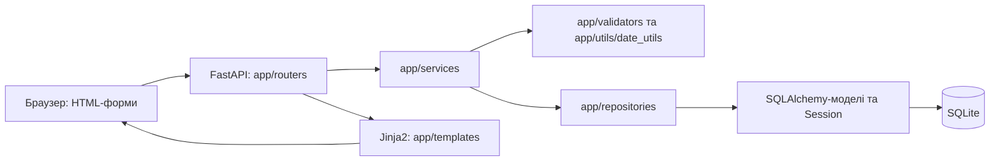

# Архітектура project_2

Карта коду гілки `testing`. Актуальний код має пріоритет; стан реалізації та результати перевірок наведені в [CURRENT_STATE.md](CURRENT_STATE.md).

## Навігація за завданням

Шляхи в таблицях наведено від кореня репозиторію. Для конкретного завдання достатньо відповідного рядка та пов'язаного розділу нижче.

| Завдання | Основні файли |
| --- | --- |
| Список, створення, базове редагування людини | `app/routers/persons.py`, `app/services/person_read.py`, `app/services/service_person_create.py`, `app/repositories/person_repository.py`, `app/templates/persons.html`, `app/templates/person_form.html` |
| Стать, відмінки ПІБ, створення особи, /admin та Excel | `docs/NAME_CASES.md`, `app/name_cases.py`, `app/models/name_cases.py`, `app/services/person_registration.py`, `app/services/name_cases.py`, `app/services/name_dictionary_import.py`, `app/repositories/name_case_repository.py`, `app/routers/admin.py`, `app/routers/name_cases.py`, `app/security/admin.py` |
| Предметні дати, фільтри та системний час | `app/date_fields.py`, `app/utils/date_utils.py`, `app/utils/date_query.py`, `app/templates/components/date_*.html`, `app/static/js/date_*.js`, `docs/DATE_SYSTEM.md`, `tests/test_date_system.py` |
| Історія ПІБ | `app/routers/person_name.py`, `app/services/service_person_name.py`, `app/models/person_identity.py`, `app/templates/person/components/names_history.html` |
| Історія звань | `app/routers/person_rank.py`, `app/services/service_person_rank.py`, `app/models/person_military_service.py`, `app/templates/person/components/rank_history.html` |
| Версії штатів, історія, імпорт Excel | `docs/STAFF_HISTORY.md`, `app/models/staff.py`, `app/services/staff_*.py`, `app/repositories/staff_repository.py`, `app/services/person_picker.py`, `app/services/assignment_events.py`, `app/routers/staff.py`, `app/templates/staff_*.html` |
| Посади, призначення, фільтри | `app/routers/person_positions.py`, `app/services/service_person_positions.py`, `app/repositories/position_table_repository.py`, `app/models/person_positions.py`, `app/templates/person_positions.html`, `tests/test_person_positions.py` |
| Каталог полів, видимість колонок, Checkbox Tree | `app/table_fields.py`, `docs/TABLE_FIELDS.md`, `app/table_columns.py`, `app/templates/components/column_visibility.html`, `app/static/js/column_*.js`, `app/static/js/table_*.js`, `app/static/css/column_visibility.css`, `tests/test_table_columns.py`, `tests/js/`, `tests/browser/` |
| Події | `app/services/service_for_person_event.py`, `app/services/service_common_event_func.py`, `app/repositories/event_repository.py`, `app/models/person_event.py`, `app/validators/event_validatotor.py` |
| Довідники та початкові дані | `app/models/reference_book.py`, `app/seeds/seed_structure.py`, `app/seeds/seed_reference.py`, `app/config.py`, `reference_data.xlsx` |
| Окреме засівання тестових людей | `app/services/seed_test_people.py`, аркуш `persons` у `reference_data.xlsx`, `tests/test_seed_test_people.py` |
| Підключення застосунку, БД, тестів | `app/main.py`, `app/templating.py`, `app/database/`, `requirements.txt`, `tests/conftest.py` |

## Компоненти та потік запиту

Вебзастосунок — FastAPI з серверним рендерингом Jinja2. [app/main.py](../app/main.py) створює `app` і підключає сім роутерів: `persons`, `person_name`, `person_rank`, `person_positions`, `staff`, `name_cases`, `admin`. JavaScript і CSS сторінок переважно розміщені в HTML; спільний компонент видимості колонок має файли в `app/static/`. `StaticFiles` у `app/main.py` обслуговує `/static` з абсолютного шляху `BASE_DIR / "static"`. Bootstrap завантажується з `cdn.jsdelivr.net`. Окремого frontend-збирання у репозиторії немає. PySide6 є в залежностях, але не є точкою входу поточного вебінтерфейсу.

Маршрути обробляють HTTP-параметри, відповіді й вибір шаблону; предметних ORM-запитів в активних роутерах немає. Сервіси виконують валідацію та кадрові операції, репозиторії будують SQLAlchemy-запити й додають/видаляють записи. Сервіси читання повертають записи та словники, без HTML. Спільний `app/templating.py` налаштовує Jinja2 та форматування дат; роутери більше не імпортують один одного заради templates. Окремих базових Repository/Service або DTO для кожного простого CRUD не введено.

## База даних і життєвий цикл сесій

- [app/database/base.py](../app/database/base.py) містить спільний `Base`; [app/models/__init__.py](../app/models/__init__.py) реєструє моделі для `Base.metadata`.
- [app/database/db.py](../app/database/db.py): SQLite `data/database/project2.db`, `engine`, `SessionLocal`, залежність FastAPI `get_db()`. Вона відкриває сесію на запит і закриває її у `finally`, без автоматичного commit.
- `app/database/db_test.py`: окремі `engine_test`, `SessionLocal_test`, `get_test_db()` для `data/database/project2_test.db`.
- Обидва шляхи БД відносні до робочого каталогу. Шаблони також шукаються відносно нього: `app/templates`.
- `app/database/init_db.py` та `init_test_db.py` імпортують реєстр моделей і викликають `create_all`. CLI `init_db` створює лише новий файл; пересоздання вимагає `--recreate` з явним `--database`. `schema_check.py` перед засіванням лише перевіряє поточні таблиці/колонки, SQLite-тригери та відсутність застарілої фізичної person_positions. Автоматичних міграцій немає. Для додавання статі й словників існує явна адитивна `app/database/migrate_name_cases.py` з резервною копією та rollback; вона вимагає попередню штатну схему й не відновлює ще старіші схеми. Формат і команда — [NAME_CASES.md](NAME_CASES.md#безпечне-оновлення-існуючої-sqlite).

### Єдині правила транзакцій

Життєвий цикл Session і володіння бізнес-транзакцією — різні відповідальності. Репозиторії не відкривають/закривають сесії й не викликають commit/rollback. `flush()` допускається для отримання ID; у кадрових сервісах він також забезпечує правильну послідовність перевірок тригерів.

| Операція | Власник транзакції |
| --- | --- |
| Створення/редагування людини, ПІБ, звання | `service_transaction(db)` у `app/database/transactions.py`: одна сервісна операція, flush + commit, rollback при помилці валідації/збереження. Сесію закриває її постачальник. |
| Спільна операція осіб/подій | Зовнішній виклик, наприклад `with factory.begin() as db`. Для сервісів особи/ПІБ/звань передати `commit=False`, для подій — `db=db`. Вони можуть flush, але не commit/rollback/close. Після будь-якої помилки зовнішній власник має відкотити всю операцію; помилку не можна приховувати й потім commit частину змін. |
| Штатні записи, перепризначення, закриття та HTTP-імпорт | Чинний `staff_service.write_unit`: відмова за pending-змін виклику, звільнення старої read-only транзакції, SQLite `BEGIN IMMEDIATE`, повторне читання/перевірка revision, один commit або повний rollback. Його не вкладати у сторонню write-транзакцію. |
| Нова форма особи / імпорт словників | person_registration об’єднує створення Person, PersonName, персональні форми та наявний сервіс звання в одному service_transaction, без вкладених commit. Імпорт словників використовує service_transaction(immediate=True): BEGIN IMMEDIATE, перевірка revision/квитанції, один commit або rollback. |
| Окремий виклик сервісу подій | `session_scope` у `app/database/transactions.py`: сумісний виклик без db використовує SessionLocal або явний session_factory, сам завершує транзакцію та закриває сесію. Повернені ORM-поля залишаються завантаженими. Читання не робить commit. |
| Засівання довідників / тестових людей | Довідники: одна CLI-операція з commit у seed_all_structure і rollback у CLI. Люди: окрема зовнішня `session_factory.begin()` на рядок. insert_prepared не робить commit, бо використовується й усередині seed-транзакції. |

Стандартні операції осіб відмовляють за незбережених `new/dirty/deleted`, щоб не зберегти сторонні pending-зміни. Це не механізм виявлення всіх уже flush-нутих сторонніх записів: для будь-якої спільної write-транзакції обов’язкові `commit=False`/`db=db`. Самостійний режим не слід змішувати зі сторонніми записами в тій самій Session. Старі positional-аргументи сервісів та session_factory подій збережено; при одночасному db і session_factory повертається ValueError.

### Репозиторії й читання

| Модуль у app/repositories | Відповідальність |
| --- | --- |
| `person_repository.py` | Person, поточні/історичні ПІБ і звання, довідник Rank, список людей, bulk-запит person picker. `history_selection` спільний із таблицею посад. |
| `staff_repository.py` | Структури, версії, посади, призначення, вибірки на дату/період і пошук перетинів. Рішення про допустимість/виправлення/закриття залишаються у StaffService; чинні обмеження ORM/SQLite не змінені. |
| `position_table_repository.py` | Join таблиці посад, allowlist ORM-полів, SQL фільтрів/дат/зайнятості та однорівневе сортування. Не виконує кадрових записів. |
| `name_case_repository.py` | Словники за типом/статтю/ключем, персональні форми person_name_id та квитанції імпорту. Без commit/rollback або автоматичного відмінювання. |
| `event_repository.py` | Події, типи/підтипи, вибірки/конфлікти та add/delete. Перевірка людини, підтипу й календаря та обчислення тривалості — у сервісах. Чинні строгі межі finite-overlap сервісу подій збережено; їх не прирівняно до включних меж штатних періодів. |

`person_read.py` готує дані списку/карток; `staff_read.py` — версії та дату перегляду, історію й дані підтвердження. `service_person_positions.py` координує читання та обчислює значення/попередження/варіанти фільтрів; SQL виконує PositionTableRepository. ORM-записи залишаються доступними Jinja2, включно з наявними lazy-колекціями картки людини; повне переведення шаблонів на DTO не виконувалося.

## Моделі та зв'язки

| Файл / клас | Таблиця | Призначення та зв'язки |
| --- | --- | --- |
| `person.py` / `Person` | `persons` | Базова людина: ID, nullable sex із CHECK male/female, nullable унікальний `tax_number`, окремі nullable `birth_day`, `birth_month`, `birth_year`. ORM-колекції `names`, `ranks`, `service_history`, `positions`. |
| `person_identity.py` / `PersonName` | `person_names` | ПІБ та необов'язкові латинські варіанти; FK на `Person`, зворотний ORM-зв'язок `person`. |
| `person_identity.py` / `Passport` | `passports` | Тип, серія, номер, орган, компоненти дат видачі/закінчення та сумісні Date-проєкції; FK на `Person`. ORM-колекції паспортів у `Person` не оголошено. |
| `person_military_service.py` / `PersonRank` | `person_ranks` | FK на `Person` і довідник `Rank`, номер та три nullable компоненти дати наказу; ORM-зв'язки `person`, `rank`. |
| `person_military_service.py` / `PersonServiceHistory` | `person_service_history` | Вид служби, частина, текстова посада, компоненти дат посади/наказу; FK та ORM-зв'язок на `Person`. Це окрема сутність від штатного призначення. |
| `reference_book.py` / `Rank` | `ranks` | Унікальний `code` і сім відмінкових форм звання. |
| `reference_book.py` / `Position` | `positions` | Посада конкретного StaffVersion, унікальна пара staff_version_id/position_number; реквізити, системні UTC-поля, revision. Колекція persons містить історичні PersonAssignment. |
| `staff.py` / `StaffStructure`, `StaffVersion` | `staff_structures`, `staff_versions` | Структура та її непересічні точні періоди; версія має власні Position. |
| `staff.py` / `PersonAssignment` | `person_assignments` | Єдине джерело історичних і поточних призначень; person_id, staff_position_id, assigned_from/to, UTC-поля, revision. |
| `person_positions.py` / `PersonPosition` | Немає окремої таблиці | Deprecated alias PersonAssignment; друге джерело поточного стану не створюється. |
| `name_cases.py` / `NameDictionary` | `name_dictionaries` | Три типи ПІБ, явна стать, нормалізований ключ, оригінальні сім форм, is_verified, UTC та revision. Унікальна трійка kind/sex/normalized_key. |
| `name_cases.py` / `PersonNameCases` | `person_name_cases` | FK конкретного PersonName, частина ПІБ, знімок слова/статі, nullable форми, is_verified, UTC/revision. Видалення саме цього ПІБ каскадно видаляє його форми. |
| `name_cases.py` / `NameDictionaryImport` | `name_dictionary_imports` | Квитанція підтвердження імпорту, стабільний унікальний ID, digest/режим/UTC, захист повторного POST. |
| `event_type.py` / `EventType` | `event_types` | Код і назва типу події, колір, ознаки активності та виключності. |
| `event_subtype.py` / `EventSubtype` | `event_subtypes` | Код, назва, активність; FK на `EventType`. |
| `person_event.py` / `PersonEvent` | `person_events` | FK на `Person`, `EventType`, необов'язковий `EventSubtype`; початок, тривалість, кінець, наказ, мета, місце, примітка, статус. ORM-колекцію `Person.events` не оголошено. |

Файли моделей у таблиці розташовані в `app/models/`. `HistoryModel` у `person_history_model.py` — абстрактний базовий клас для `PersonName`, `Passport`, `PersonRank`, `PersonServiceHistory`: додає `created_at`, `updated_at`, `is_active`. Він **не** додає `date_from` / `date_to` й не є журналом усіх змін. Нові StaffStructure/StaffVersion/PersonAssignment та Position використовують SystemTimestamps із тією самою точною UTC-політикою, без is_active. Базові Person і PersonEvent від HistoryModel не успадковуються.

Основні зв'язки: `Person → PersonName[]`, `Person → PersonRank[] → Rank`, `Person → PersonServiceHistory[]`, `Person → PersonAssignment[] → Position → StaffVersion → StaffStructure`. Паспорт і подія посилаються на людину через FK; підтип події — на її тип. Поточність призначення визначається його фактичними датами та періодом версії.

## Сервіси та правила даних

| Модуль у `app/services/` | Поточна відповідальність |
| --- | --- |
| `service_person_create.py` / `ServicePersonCreate` | Створює `Person` з явною статтю і початковий активний `PersonName`; базове редагування змінює активний запис ПІБ на місці, без нового запису історії. |
| `service_person_checking.py` / `ServicePersonCheck` | Перевіряє наявність людини й унікальність ІПН, з можливістю виключити поточну людину. |
| `service_person_group_data_validation.py` / `DataGroupValidate` | Нормалізує базові дані та ПІБ через `PersonValidator` і `validate_date_components`. |
| `service_person_name.py` / `ServicePersonNameFunc` | Додавання нового ПІБ деактивує поточний; редагування працює з конкретним записом, зокрема частковими даними. Є перемикання активного запису та видалення неактивного з підтвердженням `DELETE`. |
| `service_person_rank.py` / `ServicePersonRankFunc` | Звання обирається з `Rank`. Перше стає активним, наступне додається неактивним; активність перемикається окремо. Додавання перевіряє повтор того самого звання в історії. Є редагування та видалення неактивного запису з `DELETE`. |
| `service_person_positions.py` / `ServicePersonPositionFunc` | Координація PositionTableRepository, значення/попередження рядків і варіанти фільтрів; кадрові записи делеговано StaffService. |
| `service_common_event_func.py` / `CommonEventFunc` | Пошук подій, типів і підтипів; перевірка належності підтипу до типу. Читання подій за person_id, незалежно від посад. |
| `service_for_person_event.py` / `PersonEventService` | Підготовка, створення, зміна, видалення події, пошук за датами та конфліктами. У вебмаршрутах не використовується; підтримує backdated створення/редагування точних дат; історичні посади читає assignment_events.py. |
| `service_common_person_func.py` / `CommonPersonFunc` | Перевірена фабрика `add_pasport` без запису в БД. Невикористаний зламаний update_person видалено після пошуку викликів. |
| `check_events.py`, `check_person_events.py` | Явні CLI-діагностики через session_scope/EventRepository; імпорт більше не відкриває БД. |

### ПІБ, відмінки та адміністративний доступ

Повний формат, маршрути, безпечна міграція й налаштування — [NAME_CASES.md](NAME_CASES.md). Конфігурація app/name_cases.py спільна для компонентів і Excel: шість аркушів задають категорію/стать, EXCEL_HEADERS/EXCEL_LABELS — два рядки заголовків, записи — з рядка 3. Поля ручного редактора окремо зберігають sex. Отримання форми: актуальний персональний знімок конкретного PersonName → перевірений словник тієї самої статі → NULL із попередженням. Стать не визначається з ПІБ. Зміна слова/статі робить знімок stale; словниковий імпорт ніколи не перезаписує персональні форми.

Нова person_create.html використовує компоненти name_case_fields.html, date_input.html і name_cases.js. Після створення — person_created.html з двома переходами; person_form.html збережено для базового редагування. Особисті відмінки редагує person_name_cases.html через посилання конкретного запису історії.

Повної системи користувачів/ролей немає. За замовчуванням словниковий /admin потребує PROJECT2_ADMIN_TOKEN: підписана cookie, HTTPS і CSRF; без секрету операції вимкнені. Виняток для розробки — PROJECT2_DEV_ADMIN_OPEN=1: app/security/admin.py дозволяє обійти вхід і CSRF тільки при прямому loopback-з'єднанні та Host localhost/127.0.0.1/::1, без forwarded-заголовків і стороннього Origin/cross-site. Решта запитів використовує звичайний захист. Окремий внутрішній тип локального owner дозволяє тим самим роутерам працювати без секрету; імпортні preview/confirm і бізнес-правила незмінні. Публічний lookup тільки читає перевірені дані. app/service_basis.py — незалежні стандартні формулювання служби для майбутніх колонок, без запису в історію служби.

### Валідація й дати

`PersonValidator` перевіряє ПІБ спільним word-валідатором: NFC/strip без зміни регістру, 1–100 символів, літери Unicode, внутрішні апострофи/дефіси/пробіли; перевіряє десятизначний ІПН, повні дати `DD.MM.YYYY` і окремі паспортні поля. Наявність паспортних валідаторів не означає готовий паспортний інтерфейс.

`app/date_fields.py` містить явні `DateField`-політики: неповнота дозволена для народження, дат паспорта, наказу про звання та історії служби. Рік народження не більший за поточний; для решти цих дат допустимий календар Python 1–9999. Подія має обов'язковий точний початок; кінець/наказ можуть бути відсутніми, але задані значення повні. `HistoryModel.created_at/updated_at` лишаються точними системними DateTime з чинною UTC-політикою. Поточна схема й команди створення/пересоздання — у [DATE_SYSTEM.md](DATE_SYSTEM.md).

`PartialDateMixin` (`app/models/partial_date_mixin.py`) додає спільну ORM-перевірку для `Passport`, `PersonRank`, `PersonServiceHistory`. У них 15 нових nullable Integer; компоненти — джерело значення. П'ять SQL Date збережено як сумісні проєкції: точне значення лише для повної дати, інакше NULL. Hybrid-властивості старих назв підтримують повний date/None ввід; на insert/update проєкції синхронізуються з перевіреними компонентами. `date_components(prefix)` та `date_binding(prefix)` підключають кожне поле до спільного форматування, possible match і сортування; raw SQL/bulk-записи обходять ці ORM-події.

`app/utils/date_utils.py` розширює наявні `DateComponents` та календарний валідатор; `validate_field_date` застосовує політику, `parse_exact_date` повторно використовується наявними валідаторами. `format_partial_date` завжди повертає три складові з `_`, наприклад `15._.1995`, `_._._`. Jinja-функції підключаються через `register_date_globals`; компоненти введення `date_input.html` / `date_input.js` інтегровані у форму людини та модальні форми звання. Унікальний `id_prefix` запобігає конфліктам ID кількох форм. `date_values_from_input` читає компоненти/старий точний ввід, зберігає пропущені частини при сервісному редагуванні й відхиляє змішані формати. Уточнення дати оновлює поточний `Person` або `PersonRank`, без додавання історії лише через уточнення.

`app/utils/date_query.py`: `DateFilter` перевіряє параметри пошуку, `possible_match` перевіряє існування повної календарно допустимої дати без доповнення даних у БД. `DateBinding` отримує **явно дозволені ORM-вирази** для трьох компонентів; `exact` адаптує чинний SQL `Date`. Метадані HTML не використовуються для довільного SQL. Для SQLite binding реєструє детерміновану функцію `project2_date_match` на поточному підключенні; це не зміна схеми. Для іншої СУБД потрібен окремий адаптер; великий обсяг даних може потребувати оптимізації, оскільки перевірка неповних дат виконується на рядках через Python-функцію SQLite.

Сортування використовує SQL-вирази: точні дати → неповні → повністю невідомі; всередині — три компоненти в обраному пріоритеті з NULL після відомих значень при обох напрямках. Текстове відображення не бере участі в порівнянні. Точні системні DateTime зберігають автоматичну UTC-логіку `HistoryModel`; SQLite повертає naive datetime, форматування явно показує UTC з часом і мікросекундами. Audit Log не реалізовано.

У списку `/persons` чинний URL-ключ `sort_by=birth_year` залишено для сумісності; він також використовує спільне сортування повної дати за роком/місяцем/днем. Інші ключі сортування не змінені. Перестановка компонентів однієї дати не є багаторівневим сортуванням різних колонок.

`components/date_filter.html`, `date_filter.js` і `date_fields.css` — спільне Bootstrap-меню за `column.date`: пошук років із checkbox, незалежні множинні компоненти, відкриті/закриті діапазони, тільки неповні дати та керування пріоритетом. Пошук дозволяє вибрати рік, якого немає серед відомих компонентів записів, щоб не виключати потенційний збіг невідомого року. Системна політика не створює меню предметної дати.

У посад підключено шість дат: `birth_date`, `rank_order_date`, `passport_issued_date`, `passport_expire_date`, `service_position_date`, `service_order_date`; видимою типово є лише народження. Фільтри — окремі JSON-параметри цих назв у чинних `FILTER_KEYS` і `filter_order`; `DATE_FILTER_COLUMNS` має явні bindings, а `DATE_FILTER_RECORDS` відрізняє невідому дату наявної людини/звання/паспорта/служби від відсутності самого запису. Каскадні варіанти враховують решту фільтрів. Пріоритети `<column-key>_priority` передаються й зберігаються незалежно за колонками як `project2:date-priority:<table-id>:<column-key>` (`version: 1`). Вони не входять до пресетів чи історії фільтрів. Наявні `QueryFilterAdapter` / `TableTimeline` очищають фільтр прихованої колонки й відновлюють його через undo/redo.

### Посади та фільтри

Базова вибірка починається з Position конкретної StaffVersion, додає PersonAssignment на вибрану as_of дату й людину та через агреговані підзапити обирає ПІБ, звання, паспорт і службу. Погоджене правило: єдиний запис загалом → він, інакше єдиний активний → він; кілька записів без єдиного активного → порожні поля й попередження. Кожен підзапит повертає максимум один ID на людину; outerjoin не множить посади та зберігає вакансії. Звання з довідника й реквізити наказу належать одному вибраному PersonRank. Список людей для призначення використовує той самий вибір ПІБ/звання та обчислений статус на дату.

`app/table_fields.py` явно прив’язує 54 поля до довірених ORM-джерел, їхніх типів, форматування й SQL-виразів; `app/table_columns.py` вибирає поля поточної таблиці. PositionTableRepository формує allowlist: 40 скалярних фільтрів, шість DateBinding та сортування всіх 54 полів. Вісім точних системних DateTime доступні лише для сортування. ПІБ має узгоджене SQL-вираження; числа й дати не сортуються як відформатований текст. Повний перелік моделей, джерел, nullable, історичності й обмежень — у [TABLE_FIELDS.md](TABLE_FIELDS.md).

Варіанти фільтра колонки враховують решту фільтрів та зайнятість, виключаючи власний фільтр. Для неактивних колонок вони виводяться з уже отриманих рядків, для кожного активного фільтра потрібен один додатковий SQL-запит. Кількість запитів незалежна від кількості людей/колонок: 1 + число активних колонкових фільтрів для результату/варіантів та один запит для людей. Значення готуються в `row["values"]`; предметного словника чи логіки вибору запису в HTML немає.

`filter_order` зберігає порядок увімкнення фільтрів для URL та номерів у заголовках; це не пріоритет багаторівневого сортування. Є один вибраний ключ сортування та додаткові ключі стабілізації порядку. Перепризначення закриває попередній період без видалення; зайнята ціль дає конфлікт. Звільнення завершує період.

### Колонки, пресети та історія

[app/table_fields.py](../app/table_fields.py) — спільний каталог TableField з українськими назвами, групами, джерелами та типами. [app/table_columns.py](../app/table_columns.py) містить `table_configuration`: впорядкований вибір полів за групами та незалежні перевизначення назви/видимості/розмірів. `PERSON_POSITIONS_COLUMNS` має ID `person-positions`, 54 інформаційні та дві службові колонки; типово видимі попередні 12. Групи: штатна посада, звання, особисті дані, служба, документи, системні дані. Нові поля й усі системні дані типово приховані. Ключі попередніх колонок збережені для пресетів.

Метадані `system`, `draggable`, `resizable`, `min_width`, `width` визначають поведінку UI; `date` підключає чинне меню предметної дати, `data_type/filterable/sortable/source/nullable/historical/optional_record/selection_source` описують поле. `system_data` позначає системні дані моделі, але **не** блокує їх приховування: `system=True` залишається тільки у нерухомої `row_number`. Форма призначення — окрема неінформаційна колонка.

Роутер читає параметри лише для allowlist поточної таблиці; назви ORM-моделей/атрибутів ніколи не беруться із запиту. SQL-джерела існують лише на сервері, клієнт отримує серіалізовані метадані. `table_column_filters` містить лише фільтровані поля; сортування системних DateTime дозволяється окремим SORT_KEYS. Усі колонки рендеряться циклом конфігурації без ручного дописування предметних комірок.

Макрос `column_visibility(config, filters=none)` у [components/column_visibility.html](../app/templates/components/column_visibility.html) формує спільну flex-панель: «Колонки», «Зберегти пресет», «Назад / Вперед» і необмежений список кнопок пресетів зі шестернею. Кнопки переносяться на наступний рядок, назви — всередині кнопок. Макрос `column_tree(config, prefix)` використовується і в початковому dropdown, і в редакторі пресету; окремого дерева для посад немає. Всі модальні вікна Bootstrap мають ID з префіксом таблиці.

| JavaScript у `app/static/js/` | Відповідальність |
| --- | --- |
| `table_state.js` | `ColumnModel`: нормалізація видимості/порядку, системні колонки, ширина; `LocalTableStorage`: JSON-зберігання; async-інтерфейс `PresetStorage`, його локальна реалізація та `PresetManager` з перевіркою назв, ID і форматів. |
| `column_tree.js` | Спільний `CheckboxTree`: групові/окремі checkbox, нативний `indeterminate`, згортання; у редакторі приховує вже вибрані дочірні рядки. |
| `column_presets.js` | `PresetPanel`: кнопки й модальні вікна створення, конфлікту назви, редактора та підтвердження видалення. Сховище можна передати через конструктор. |
| `column_interactions.js` | Drag & Drop заголовків, індикатор вставлення, захист інтерактивних елементів; resize правої межі й відновлення ширин через `colgroup`. |
| `table_filters.js` | `QueryFilterAdapter`: читання/нормалізація дозволених параметрів, вилучення фільтрів прихованих колонок, побудова URL зі збереженням інших параметрів. |
| `table_history.js` | Чистий `TableHistory` для п'яти знімків; `TableTimeline` узгоджує історію, UI, URL, поточні налаштування та браузерні переходи. |
| `table_selection.js` | `TableSelection`: виділення комірок, TSV/HTML, Clipboard API та fallback; працює з DOM і чинним контролером, формат зберігається окремо за ID таблиці. |
| `column_visibility.js` | `ColumnController`: з'єднує компоненти для кожного `[data-column-picker]`, застосовує стан до DOM і зберігає наявну поведінку меню. |

Скрипти без збирача працюють у спільному namespace `TableColumns`. Порядок підключення: Bootstrap → `table_state.js` → `column_tree.js` → `column_presets.js` → `column_interactions.js` → `table_filters.js` → `table_history.js` → `table_selection.js` → `column_visibility.js`. CSS — `app/static/css/column_visibility.css`. Чисті модулі стану, фільтрів та історії також експортуються для Node-тестів; frontend-фреймворків не додано.

#### Застосування вигляду

Стабільні `data-column-key` визначають відповідність заголовка й комірок. Для зміни порядку контролер **переміщує наявні DOM-вузли**, зберігаючи форми та їхні обробники; рядки не сортуються. Приховування змінює `hidden`, а `colspan` порожнього результату перераховується. Поточний layout має `visible` (видимі ключі за порядком) та `order` (порядок усіх відомих колонок, включно з прихованими).

Меню «Колонки» лишається деревом без стрілок: зміни checkbox — чернетка до «Застосувати»; закриття меню її скасовує. «Скинути» повертає типову видимість, зберігаючи поточний порядок і ширини. Не можна застосувати стан без жодної інформаційної колонки. Drag & Drop і resize не запускають сортування; кнопки фільтрів та поля форм не є точками початку перетягування.

Ширина зберігається окремо від пресетів та історії; для інформаційних колонок мінімум — 100 px, значення обмежено додатним скінченним діапазоном. Таблиця має горизонтальну прокрутку. `data-column-value` містить повний текст у DOM, а `title` — підказку; CSS лише візуально обрізає його через ellipsis, зберігаючи можливість виділити й скопіювати повне значення.

#### Виділення, копіювання та приховування з заголовка

`TableSelection` підключається до `ColumnController`, використовує його конфігурацію, DOM і LocalTableStorage. Макрос панелі містить кнопку копіювання, radio Excel/Word і live-повідомлення. Формат (`version: 1`, `format: excel|word`) зберігається як `project2:table-copy:<table-id>`; початковий — Excel. Виділення — тимчасовий Set посилань на td, не новий стан колонок і не крок Undo/Redo.

Через пункт «Виділити колонку» в меню заголовка вибираються всі її видимі завантажені комірки, без сортування чи зміни layout. Копіювання запускає виключно кнопка «Копіювати». Вибираються завантажені видимі комірки tbody в поточному DOM-порядку: клік, pointer-drag прямокутника, Shift від опорної комірки, Ctrl/Meta для додавання комірок/прямокутників. Escape очищає; Ctrl/Meta+A та Ctrl/Meta+C компонент не обробляє, вони зберігають стандартну поведінку браузера; інтерактивні поля/кнопки/посилання не перехоплюються. Нумерація копіюється; заголовки з їхніми меню та колонка форми призначення не входять до вибірки. Зміна layout (приховування, пресет, переставляння, undo/redo) очищає виділення, resize зберігає. CSS використовує --table-selection-bg/border/text з Bootstrap-змінними. Нативне виділення тексту блокується лише під час перетягування комірок, на початку жесту видаляється попередній текстовий діапазон; поза жестом браузерне Ctrl+A/C не обмежується.

Для непов’язаних діапазонів експортується їхній спільний прямокутник; невибрані проміжні комірки порожні. Приховані колонки пропускаються повністю. Значення беруться з тексту data-column-value, включно з візуально обрізаним повним текстом; для простих майбутніх комірок є очищений текстовий fallback без елементів форм/кнопок/іконок. Excel отримує text/plain TSV: комірки з табуляціями/перенесеннями/лапками беруться в подвійні лапки, внутрішні лапки подвоюються. Word отримує екрановану HTML-таблицю з простими рамками та одночасний TSV fallback; перенесення у HTML — br.

ClipboardItem/write використовується для HTML, writeText — для TSV. При недоступності/відмові API є fallback через copy-event/execCommand. Якщо вдалося скопіювати лише TSV замість Word, показується явне повідомлення; повна відмова не повідомляється як успіх. Доступ залежить від браузера, secure context і дозволів. Справжню вставку в настільні Excel/Word автоматизація не перевіряє.

Пункт data-column-hide у звичайних і спеціальних меню дат делегується ColumnController: вилучає ключ з поточного layout.visible і викликає наявний commitLayout. Саме TableTimeline узгоджує Checkbox Tree, фільтри URL, збереження та Undo/Redo. Додаткового списку прихованих полів немає. Нерухома системна нумерація захищена, останню інформаційну колонку приховати не можна. Системні DateTime мають меню сортування/приховування без предметного фільтра.

#### Пресети

Обидві кнопки збереження відкривають одне модальне вікно таблиці та зберігають **застосований** вигляд, а не чернетку дерева. Назва після нормалізації пробілів має бути непорожньою й не довшою за 30 символів. Збіг назв без урахування регістру потребує явного підтвердження перезапису; при перейменуванні зайнята назва відхиляється. Назва не є ідентифікатором: створюється UUID, який зберігається при редагуванні/оновленні. Є fallback генерації UUID для HTTP-сторінок локальної мережі.

Збережений об'єкт містить лише `version`, `id`, `table_id`, `name`, `columns` (масив видимих ключів у заданому порядку). У ньому немає сортування, фільтрів і ширин. Натискання назви негайно застосовує пресет; ручні зміни поточного вигляду не змінюють його. Шестерня відкриває редактор без застосування: верхній список переміщується окремими стрілками, нижній — спільне дерево невибраних колонок. Збереження редагує тільки пресет; видалення підтверджується окремим Bootstrap Modal.

Застарілі ключі показуються користувачу як недоступні; застосовуються доступні колонки без автоматичного перезапису оригіналу. Якщо інформаційних полів не залишилося або версія не підтримується, застосування відхиляється. Явне збереження зміненого пресету може оновити його набір доступних ключів.

#### URL-фільтри та історія

**Прихована колонка не має активного фільтра.** Перед застосуванням вигляду адаптер вилучає з URL лише фільтри колонок, які стають прихованими, і перебудовує `filter_order`. Решта колонкових фільтрів, зайнятість, поточне однорівневе сортування та сторонні URL-параметри зберігаються. Якщо фільтри змінилися, виконується звичайний GET для фактичного оновлення SQL-вибірки. При прямому відкритті URL з фільтром уже прихованої колонки виконується одноразовий `location.replace`; порівняння нормалізованих фільтрів запобігає циклам. Без переданого опису фільтрів компонент не змінює URL.

Історія містить максимум **п'ять знімків разом із поточним**, кожен із layout і фільтрами (`values`, каскадний `order`, додаткова зайнятість). Послідовні однакові стани не дублюються; після переходу назад нова зміна відкидає майбутню гілку. Сортування й resize не створюють кроків. Перед застосуванням пресету зберігається попередній стан, тому undo відновлює також вилучений фільтр і відповідну серверну вибірку, залишаючи поточне сортування та ширини.

`TableTimeline` зберігає курсор між reload, а для звичайних браузерних Back/Forward записує знімок у `history.state.tableColumns[table_id]`, не стираючи сторонні поля. Відновлення враховує `back_forward`, `pageshow`/BFCache і `popstate`. Кнопки компонента працюють з обмеженою історією таблиці; браузерна історія навігації залишається окремою.

| Ключ `localStorage` | Формат |
| --- | --- |
| `project2:table-columns:<table-id>` | `version: 2`, `layout`, `widths`; підтримується читання початкового `version: 1` з `visibility`. |
| `project2:table-presets:<table-id>` | `version: 1`, масив `presets` з окремими ID та `table_id`. |
| `project2:table-history:<table-id>` | `version: 1`, `entries`, `cursor`. |

Сховище ізольоване за ID таблиці. Некоректні поточні налаштування/історія повертаються до безпечного стану; системна колонка примусово відновлюється. Помилка запису показується користувачу. `PresetStorage` має async-методи `list`, `put`, `remove`; заміна його реалізації на API не потребує зміни правил пресетів чи дерева. Наразі жодних API, користувачів або SQLAlchemy-таблиць налаштувань немає.

Для іншої таблиці потрібні власна конфігурація з унікальним ID, виклик макросу, таблиця з таким самим `id` і `data-column-table`, відповідні `data-column-key`, повні текстові значення в `data-column-value` та спільні CSS/JS. Опис URL-фільтрів необов'язковий і задається адаптером конкретної сторінки. На робочих сторінках підключено лише `/person-positions`; повторне використання перевіряється на двох інших тестових таблицях.

## Активні HTTP-маршрути

Підключення визначає `app/main.py`, а не сам факт наявності файла роутера.

| Роутер | Метод і шлях | Виклик / результат |
| --- | --- | --- |
| `persons.py` | `GET /persons` | ORM-вибірка активних ПІБ/звань, одноколонкове сортування → `persons.html`. |
| `persons.py` | `GET /persons/new`, `POST /persons/new`, `GET /persons/{id}/created` | Поетапна форма → person_registration; атомарні Person/ПІБ/відмінки/звання, збереження чернетки при 400/409, екран успіху з двома переходами. |
| `name_cases.py` | `GET /name-dictionaries/lookup` | Read-only підбір перевірених форм за типом, словом і явною статтю; без запису. |
| `name_cases.py` | `GET/POST /person_name/{name_id}/cases` | Читання й виправлення персональних форм саме цього історичного ПІБ. |
| `admin.py` | `/admin`, `/admin/login`, `/admin/logout`, `/admin/dictionaries` | Мінімальний адміністративний доступ, список/редактор словників; захищені POST із CSRF. |
| `admin.py` | `GET /admin/dictionaries/template.xlsx`, `POST /admin/dictionaries/import/preview`, `/confirm` | Порожній шаблон, перевірка та окреме атомарне підтвердження Excel. |
| `persons.py` | `GET /persons/{person_id}/edit`, `POST /persons/{person_id}/edit` | Спільна форма → `ServicePersonCreate.update_person`; успіх → `/person_detail/{id}`. |
| `persons.py` | `GET /person_detail/{person_id}` | Коротка картка, активні ПІБ/звання, історія ПІБ → `person_detail.html`. |
| `persons.py` | `GET /person_full_info/{person_id}` | Людина, активні ПІБ/звання, довідник звань → `person_full_info.html`. |
| `person_name.py` | `POST /person_name/add_new/{person_id}` | `ServicePersonNameFunc.add_new_name`. |
| `person_name.py` | `POST /person_name/{person_name_id}/update`, `/make_active`, `/delete` | Операції з конкретним записом ПІБ; перенаправлення до повної картки. |
| `person_rank.py` | `POST /person_ranks/add_rank/{person_id}` | `ServicePersonRankFunc.add_rank`. |
| `person_rank.py` | `POST /person_ranks/{person_rank_id}/update`, `/make_active`, `/delete` | Операції з конкретним записом звання; перенаправлення до повної картки. |
| `person_positions.py` | `GET /person-positions` | Сервіс посад + список людей → `person_positions.html`. |
| `staff.py` | `POST /person-positions/assign` | Призначення / звільнення; `return_query` відновлює фільтри й сортування після `303`. |

`app/routers/person_service.py` містить лише імпорти, без `router`; app/main.py його більше не імпортує. Роутерів для подій, паспортів, `/search` чи видалення цілої людини немає.

## Шаблони та взаємодія

| Шаблон у `app/templates/` | Призначення |
| --- | --- |
| `persons.html` | Список людей, вибір сортування, локальне приховування окремих колонок через JavaScript. |
| `person_form.html` | Базове редагування, внесення статі; три поля дати народження, підказки та клієнтські перевірки. |
| `person_create.html`, `person_created.html`, `person_name_cases.html` | Поетапне створення, повідомлення успіху та редагування форм конкретного історичного ПІБ; спільний макрос name_case_fields.html. |
| `admin/*.html` | Вхід, централізований розділ, словники, редактор, preview/підтвердження Excel. Словникові мутації потребують admin-сесії та CSRF, крім явно ввімкненого локального режиму розробки. |
| `person_detail.html` | Коротка картка й історія ПІБ; системні часи створення/оновлення показуються точно в UTC, стан — через `is_active`. |
| `person_full_info.html` | Повна картка; включає навігацію, модальні форми, історію ПІБ і звань. Інші вкладки — заглушки. |
| `person/components/full_info_top_navigation.html` | Посилання на коротку картку та список. |
| `person/components/modal_windows.html` | Форми додавання ПІБ і звання. |
| `person/components/names_history.html`, `rank_history.html` | Цикли по ORM-колекціях `person.names` / `person.ranks`, форми редагування, активації та видалення. |
| `person_positions.html` | Штатна таблиця, меню фільтрів, пошук значень, вибір людини, призначення; підключає спільний Checkbox Tree. Заголовки й порядок комірок визначає `table_columns`; фільтри прихованих колонок синхронізуються з URL через спільний адаптер. |
| `components/column_visibility.html` | Спільні макроси панелі, дерева й модальних вікон пресетів; назви та групування отримують лише з конфігурації. |
| `search_person.html` | Застарілий непідключений пошук зі старими полями `Person`. |
| `person/person_view.html` | Порожній файл, маршрутами не використовується. |

Форми осіб працюють через HTTP; lookup словника — асинхронний read-only JSON. Форми /staff/history використовують наявний fetch-контракт зі збереженням чернеток. Спільного базового шаблону через `extends` немає.

## Довідники, утиліти та тести

`app/seeds/seed_structure.py::seed_all_structure(db, excel_path=EXCEL_PATH)` послідовно додає типи й підтипи подій, звання та посади й виконує `commit`. CLI `python -m app.seeds.seed_structure --database PATH` працює з уже підготовленою схемою, підтримує `--excel` та rollback при помилці; тестових людей не додає. Звання беруться з `app/models/reference_data/ranks.py::ReferenceRanks.RANKS`; порожній `ReferencePositions.POSITIONS` не є джерелом штатних посад.

Посади завантажуються з кореневого `reference_data.xlsx`: `app/config.py::EXCEL_PATH`, аркуш `positions`, заголовок першого рядка, пропуск другого рядка, читання значень як тексту. staff_import.py зберігає чинне зіставлення колонок і нормалізацію. seed_reference.py повторно використовує його, вимагає явних періодів і не перезаписує вже збережені версії. Без параметрів версії seed_structure засіває лише довідники. `app/utils/json_loader.py` — загальна утиліта; для наявних JSON-файлів у `app/seeds/` підключеного імпортера в проаналізованому коді немає.

`app/services/seed_test_people.py` — незалежний від `seed_all_structure` імпортер аркуша `persons`. `seed_test_people(session_factory, excel_path)` перевіряє заголовки до відкриття сесій, читає через openpyxl всі заповнені рядки починаючи з другого й повертає `SeedReport` з лічильниками та `RowIssue` з номерами помилкових рядків. Назви обов'язкових колонок визначені в `REQUIRED_COLUMNS`; зайві колонки ігноруються. Команда й обмеження даних описані в [CURRENT_STATE.md](CURRENT_STATE.md#засівання-тестових-військовослужбовців).

Імпортер вимагає явне sex в persons, використовує `PersonValidator`, `DataGroupValidate` та PersonRepository для запису вже перевірених даних. Повні та неповні дати проходять чинний `validate_date_components` і зберігаються в трьох полях `Person`; окремого запису персональних даних немає. Звання зіставляється тільки з існуючим `Rank.code` або `Rank.nominative` без урахування регістру й зайвих пробілів. Для нового РНОКПП створюються `Person`, активний `PersonName` та активний `PersonRank` в **одній транзакції рядка**. Самостійний commit сервісів `create_person` / `add_rank` тут не використовується; інші рядки можуть успішно зберегтися після відкату некоректного. Повторний РНОКПП пропускається без оновлення даних. Команда спершу перевіряє поточну схему й не створює схеми, звань, паспортів, призначень або історії служби. Аркуш persons не має дати наказу; усі її компоненти в новому `PersonRank` залишаються NULL. Повторний імпорт не очищає внесені компоненти існуючих записів.

`reset.py` видаляє робочу БД та створює/заповнює її заново; `reset_test_db.py` аналогічно працює з тестовою. Кореневий `test_seed_positions.py` оновлює **робочу** БД при виконанні/імпорті. `test1.py` і `test2.py` — окремі утиліти звіряння Excel з папками/документами з жорстко заданими Windows-шляхами.

Автоматизовані тести розташовано в `tests/`: створення людини й історії ПІБ, неповні дати, валідатори, вибірка/фільтри/сортування та перенесення/звільнення посад. Фікстура `db` у `tests/conftest.py` викликає `drop_all` / `create_all` для тестової БД перед кожним тестом, що її використовує. Команди та межі перевірки — у [CURRENT_STATE.md](CURRENT_STATE.md).

`tests/test_seed_test_people.py` створює власні Excel-файли зі штучними даними та SQLite-бази в `tmp_path`, вмикає перевірку зовнішніх ключів і не використовує руйнівну фікстуру `db`. Перевіряє також CLI через subprocess і відкат після примусового збою запису звання.

`tests/test_table_columns.py` перевіряє конфігурацію, системну колонку, відповідність заголовків/комірок і опис URL-фільтрів. `tests/js/*.test.cjs` перевіряють чисті модулі стану, пресетів, фільтрів та історії. `tests/browser/column_visibility.cjs` запускає Chromium через Playwright і тестовий сервер `tests/browser/serve_column_visibility.py`: реальні маршрути з dependency override на SQLite в пам'яті й згенерованими даними. Окремий тестовий маршрут із двома іншими таблицями перевіряє повторне використання макросу; у production він не реєструється.

`tests/test_partial_date_models.py` перевіряє SQLite round-trip усіх комбінацій невідомих частин п'яти нових дат, ORM-валідацію, проєкції, сортування та HTTP-форми. `tests/test_database_commands.py` перевіряє захист існуючих файлів, відмову старій схемі, rollback довідників і повторне окреме засівання людей. `tests/browser/domain_dates.cjs` перевіряє модальні форми звання та дві незалежні колонки дат.

`tests/test_table_field_catalog.py` перевіряє повноту каталогу за ORM-атрибутами, ізоляцію конфігурацій, одиничні неактивні та неоднозначні історичні записи, відповідність звання/наказу, типізовані фільтри/сортування, лічильник SQL, HTTP і попередження. `tests/browser/catalog.cjs` перевіряє 56 keyed-колонок, нові джерела/дати, undo фільтра та старий пресет. Події/підподії в цьому етапі не змінювалися.

`tests/js/table_selection.test.cjs` перевіряє TSV і екранування HTML. `tests/browser/copy.cjs` перевіряє виділення, клавіші, формати, fallback/відмову доступу, фактичні MIME у буфері Chromium, приховування з очищенням фільтра/історією та незалежність двох таблиць.

Повна схема, транзакції, маршрути /staff, компонент вибору, захист імпорту, точність PersonEvent та команди БД — у [STAFF_HISTORY.md](STAFF_HISTORY.md). Старий POST /person-positions/assign із довільним person_id замінено prepare → підписане підтвердження; це навмисна зміна серверного контракту.

На /staff/history POST-форми обробляє `app/static/js/staff_history_forms.js`: клієнтські перевірки + fetch/FormData, JSON-помилка `detail/fields` із `form_failure` у роутері staff або FastAPI 422. Помилка лишає вихідний DOM/введені значення та details відкритими, показує alert, підсвічує поле й фокусує його. Успіх переходить на серверний redirect із новими даними/повідомленням. Моделі та StaffService не змінені. Регресії — `tests/browser/history_forms.cjs`, JSON-контракт — `tests/test_staff_history.py`. Деталі — [STAFF_HISTORY.md](STAFF_HISTORY.md#помилки-форм-історії).

## Географія та адреси

[GEOGRAPHY.md](GEOGRAPHY.md) описує чотири нові таблиці, м’яку перевірку, точкове оновлення форм і безпечну міграцію. app/geography.py — метадані полів; routers/geography.py → services/geography.py → repositories/geography_repository.py. PersonBirthplace обмежено населеним пунктом; PersonAddress зберігає текстові знімки, необов’язкові GeoUnit ID та незалежну історію registration/actual/correspondence. GeoAlias підтримує альтернативні назви. Вкладка «Загальна інформація» включає спільний geography.html і geography.js; старі кадрові правила та каталоги колонок не змінені.
