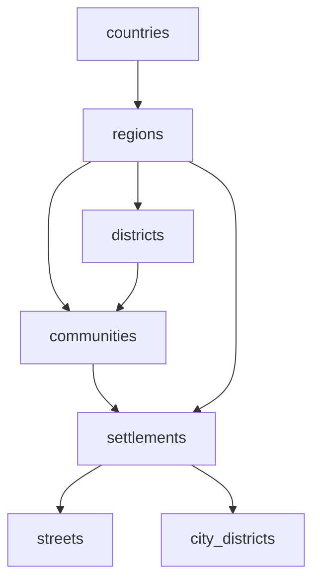

# Географічні довідники project_2: схема та завдання на реалізацію

Дата: 27.10.2026. Цей пакет не змінює код project_2.

## Призначення та принципи

Довідники використовуються для місця народження, реєстрації, фактичного проживання та інших адрес. Збереження адреси дозволене з порожніми полями, невідомим написанням, іноземним містом або історичним адміністративним устроєм. Помилки формату файлів та порушення цілісності довідника блокують його імпорт; невідповідність персональної адреси довіднику її збереження не блокує.

## Таблиці та ключі

Повний перелік колонок і типів наведено в DATA_SCHEMA.md. У CSV порожня клітинка означає NULL, а не порожній FK. Усі id — внутрішні UUID, згенеровані UUIDv5 у просторі aa6b310d-5224-47a3-9781-cc500c3cb994. Вони не є офіційними кодами. Формула: UUIDv5(namespace, table + ':' + external_identity). Для одиниць КАТОТТГ external_identity — повний офіційний код; для країн — alpha-2. Назва одиниці не входить у ключ КАТОТТГ, тому перейменування не змінює ID.

Для вулиці без офіційного ID ідентичність обмежена незмінним кортежем п’яти полів НАІС: область, район, населений пункт, внутрішньоміський контекст, повна назва вулиці. external_identity — JSON цього кортежу, ensure_ascii=False, стандартні separators Python. Перейменована вулиця без стабільного зовнішнього коду не зіставляється зі старою автоматично; потрібне документоване рішення та таблиця наступництва. UUID не робить такий зв’язок офіційним.

Основні FK:

Схема допускає пропущені рівні: district_id і community_id nullable. Київ та Севастополь представлені в regions і settlements як дві ролі одного офіційного об’єкта з однаковим зовнішнім кодом, але різними внутрішніми UUID. Не створювати для них вигаданих районів чи громад. city_districts — окрема таблиця; внутрішньоміські райони не є адміністративними districts. Коди КАТОТТГ унікальні всередині таблиці, а не між цими двома проєкціями спеціальних міст.

## Опис моделей SQLAlchemy

Рекомендовано SQLAlchemy 2.x: DeclarativeBase, Mapped, mapped_column. Це специфікація, не патч до проєкту.

- id: String(36), primary_key=True. Коди КАТОТТГ: String(19), unique=True, nullable=False для відповідних моделей. Перевіряти regex ^UA[0-9]{17}$ на імпорті.
- Назви: Unicode/Text, nullable=False. Не створювати UNIQUE(name). Дозволити повні офіційні назви будь-якої довжини.
- FK: String(36), ForeignKey(..., ondelete='RESTRICT'). Обов’язкові parents: regions.country_id; districts.region_id; communities.region_id; settlements.region_id; streets.settlement_id; city_districts.settlement_id. Інші адміністративні FK nullable. Для регіонів поза Україною потрібне окреме завантаження; їх у цьому пакеті немає.
- country_code: String(2); iso_alpha2: String(2), unique; iso_alpha3: String(3), unique nullable; iso_numeric: String(3). country_code має збігатися з країною country_id.
- source_id: String, FK на geo_sources.id; source_row: String — рядок Excel/XML або номер сторінки PDF, семантика залежить від джерела. geo_sources зберігає url, version_date, retrieved_date, sha256, license.
- aliases: entity_type + entity_id — поліморфна адресація. Звичайний ForeignKey на кілька таблиць неможливий: або додати geo_entities як спільний реєстр, або перевіряти тип і існування у сервісі. Не оголошувати неіснуючий універсальний FK. Unique(entity_type, entity_id, alias, source_id).
- Службові поля БД, яких немає в основних файлах: is_active Boolean, first_seen_batch_id, last_seen_batch_id, retired_at, name_search; історичні версії — окрема geo_entity_versions з попередніми назвами й батьківськими зв’язками.
- Індекси: settlements(region_id, name_search, settlement_type), settlements(community_id), communities(district_id), streets(settlement_id, name_search), aliases(entity_type, alias_search), усі зовнішні коди. Для SQLite case-insensitive пошуку українською не покладатися на вбудований ASCII NOCASE: зберігати окремий NFC/casefold ключ. FTS5 за наявності — додаткова оптимізація, не вимога цілісності.
- У SQLite вмикати PRAGMA foreign_keys=ON для кожного connection. Цілісність узгодженості region/district/community перевіряти сервісом імпорту або тригерами; самих окремих FK недостатньо.

## Збереження персональних адрес

Запропонувати PersonAddress: id, person_id, address_kind (birth/registered/actual/other), label, country_id?, region_id?, district_id?, community_id?, settlement_id?, city_district_id?, street_id?, house_raw?, building_raw?, apartment_raw?, postal_code_raw?, full_address_raw?, reference_version_id?, checked_at?, validation_status.

Для КОЖНОГО поля вибору зберігати {raw_text, selected_id nullable, is_unconfirmed, validation_status, validation_reason}. Можлива реалізація: нормалізовані AddressFieldValue або явні *_raw, *_id, *_status колонки. raw_text зберігається завжди, включно з підписом вибраного пункту на момент введення. Нове поле house/apartment не перевіряти за цим набором: даних про будинки немає. Місце народження може мати історичне написання; підтвердження історичної назви не переписує документ.

Адреса не видаляється при оновленні довідника. Об’єкти вилучені з нового джерела зберігаються як неактивні; RESTRICT захищає існуючі адреси. Якщо змінився район, зберегти попередній зв’язок у версії й повторно перевірити поточну адресу; не переписувати старі документи. Старий напис із документа і поточний підпис довідника показувати окремо.

## Автодоповнення та стани

1. Поля необов’язкові. Будь-яке поле приймає довільний текст. Окремий видимий пункт «Залишити введений текст» не прив’язує його до довідникового ID.
2. Після вибору країни фільтрувати регіони; області — райони та громади; населеного пункту — тільки його вулиці. Для інших країн показувати, що детальних даних немає, і дозволяти ручне введення.
3. Окремий пошук населеного пункту без попереднього вибору області: q + optional filters; результат містить назву, тип, область, район, громаду та ID. Однойменні пункти показувати окремо. Після вибору заповнити предків лише з підтверджених зв’язків; NULL не вигадувати.
4. matched — вибраний ID існує та підтверджені зв’язки узгоджуються. mismatch — вибрані відомі ID суперечать один одному. unknown — ручний текст без підтвердженого ID, пропущена потрібна ланка або немає покриття довідника. Сам факт відсутності вулиці не є mismatch. Порожня необов’язкова адреса — unknown без нав’язливого попередження.
5. Агрегування: якщо будь-яке поле mismatch — адреса mismatch; інакше, якщо є непідтверджене непорожнє поле або бракує даних для зв’язку — unknown; інакше matched для вибраної відомої частини адреси. Відсутність квартири не знижує підтвердження географічної частини. Показувати scope перевірки (наприклад «Населений пункт і вулиця»); не обіцяти перевірку номера будинку.
6. При зміні батьківського поля повторна перевірка всіх нащадків. Зберегти raw_text. Попередній ID залишити як конфліктний до явного рішення користувача; не використовувати його як узгоджений. Запропонувати «Очистити вибір», «Обрати інший», «Зберегти як ручний текст». Не видаляти дані непомітно.
7. Набір НАІС неповно зіставлений: відсутність підказок означає unknown. Пошук за aliases має вказувати «Попередня назва → поточна», джерело та спостережену дату; клік зберігає введений текст і окремий зв’язок.
8. debounce 250–350 мс; мінімум 2 символи, limit<=50, cursor pagination; cancellation і request sequence guard проти застарілих відповідей. Клавіатурна навігація, текстові пояснення станів, не лише колір. Дані про персональні адреси не відправляти стороннім сервісам.

Контракти майбутніх API: GET /api/geo/{countries|regions|districts|communities|settlements|streets}?q=&parent_id=&cursor=&limit=; settlements допускає region_id/district_id/community_id і пошук без них. POST /api/geo/validate отримує поля з raw_text та ID і повертає для кожного {status,reason,expected_parent_ids,coverage}, overall_status та checked_version. Оновлення тексту без нового вибору скидає selected_id після явного редагування цього поля й ставить is_unconfirmed=true. Підказка ніколи не вважається вибором автоматично.

## ТЗ для Codex: імпорт через /admin

Мета: окремий розділ /admin/geography/import із завантаженням CSV/XLSX цього пакета. Не імпортувати звіти streets_unresolved чи countries_excluded як довідники.

Порядок: geo_sources → countries → regions → districts → communities → settlements → city_districts → streets → aliases. Excel: перший рядок ключі, другий пропустити, дані з третього; CSV UTF-8 BOM, роздільник ;, один рядок заголовка, дані з другого. Порожні строки пропускати. У CSV не пропускати перший запис як «українські заголовки». Коди завжди читати як str. Ніколи не генерувати зовнішні коди з назви.

Етапи: upload → staging → schema/encoding/duplicate/FK/hierarchy validation → diff preview → explicit apply → transactional publish. Preview показує added/changed/unchanged/absent, розбіжності та приклади. dry-run доступний без зміни БД. Помилкові зв’язки відокремлюються; пакет не публікується частково без окремого явно обраного режиму. Для великих CSV читання потокове, staging з batch insert; progress і cancel до commit.

Ідемпотентність: source_id + sha256 + table + stable external key. Повтор того самого файлу не створює дублікати. Для КАТОТТГ upsert за повним кодом; зберігати існуючий внутрішній ID, навіть якщо політика UUID у наявній БД інша — тоді потрібна таблиця перекодування усіх FK пакета. Для вулиць без зовнішнього коду використовувати пакетний UUID і source identity; не зіставляти перейменування за схожістю. Оновлення не змінює IDs існуючих PersonAddress.

Відсутність запису не означає ліквідацію: тільки підтверджений повний snapshot відповідного scope дозволяє deactivate missing. Для вулиць цього пакета така операція ЗАБОРОНЕНА: покриття зіставлення часткове. Повну історію змін зберігати окремо, відкат — перемикання версії з повторною перевіркою адрес, а не видалення довідника.

Доступ: лише admin role; серверна перевірка ролі, CSRF для cookie-auth, ліміти upload/decompression/рядків, allowlist розширень, перевірка реального формату, заборона XML external entities/network fetch, захист ZIP path traversal, формули Excel не виконувати. Audit: хто, коли, hashes, результати dry-run/apply, версії до/після. Audit не повинен містити персональних адрес.

Критерії приймання: повторний імпорт без дублів; rollback після помилки; однойменні села та вулиці не зливаються; Київ без штучної громади; city_district не стає district; пропущені рівні допускаються; невідома адреса зберігається; зміна області не стирає ручну вулицю; оновлення довідника зберігає raw_text і FK старих адрес; alias показує поточну назву без примусової заміни; вулиця іншого поселення дає mismatch; відсутня вулиця дає unknown; сервер повторює перевірку незалежно від GUI; пагінація стабільна; кириличний casefold працює.
